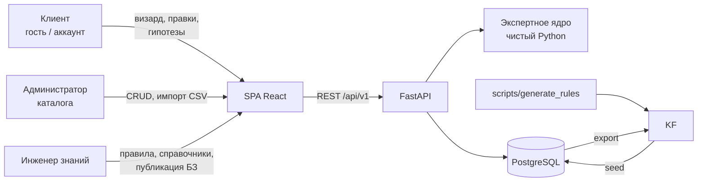
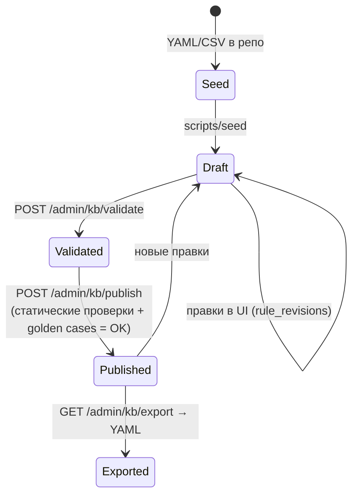
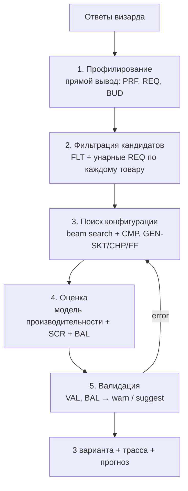
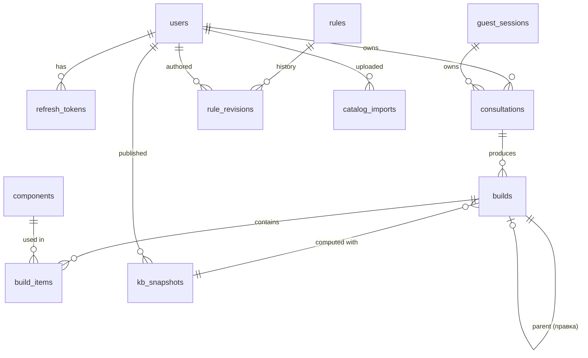

# Архитектура экспертной системы «Подбор комплектующих для ПК»

> Статус: черновик v0.1 (2026-10-19), на согласовании.
> Основание: концепция `tz.docx`, решения из опроса (раздел 1).
> Документ живой: любое архитектурное изменение сначала фиксируется здесь.

---

## 1. Принятые решения

| Область | Решение | Комментарий |
|---|---|---|
| Backend | Python 3.12+, **FastAPI**, Pydantic v2, SQLAlchemy 2 (async) + asyncpg, Alembic | Flask из ТЗ заменён на FastAPI: в ТЗ FastAPI был ошибочно записан во фронтенд. Строку о стеке в ТЗ нужно поправить |
| БД | **PostgreSQL** 16+ | Характеристики-слоты фреймов хранятся в JSONB |
| Frontend | **React + TypeScript + Vite + Mantine**, TanStack Query, React Router | API-клиент генерируется из OpenAPI |
| Запуск | Локально, без Docker | PostgreSQL установлен в системе |
| Машина вывода | **Собственный движок**: прямой и обратный вывод | Без внешних rule-engine библиотек |
| Модель знаний | Фреймы (компоненты, профиль, сборка) + продукции (JSON-DSL) | Гибрид, как в ТЗ |
| Неопределённость | **Коэффициенты уверенности** (CF, в стиле MYCIN) | Жёсткая совместимость остаётся булевой |
| Хранение правил | Seed-файлы YAML → БД (источник истины) → экспорт обратно в YAML | В БД ведётся история версий, публикуются снимки |
| Каталог | CSV по категориям, заполняются вручную, затем seed | Приложение в рантайме внешние сайты не трогает |
| Объём базы правил | **≥ 500**: ~255 ручных + ~275 сгенерированных из справочных таблиц | Раздел 6.5 |
| Диалог | Пошаговый визард + кнопки правок сборки | NLU/LLM не используем |
| Бенчмарки | Референсные индексы производительности + формула узкого места | Раздел 8 |
| Роли | Клиент (гость или аккаунт), администратор каталога, инженер знаний | + суперадмин для управления пользователями |
| Auth | Гостевая сессия + опциональный аккаунт; JWT access + refresh с ротацией | RBAC |
| Функции сборки | 3 варианта (эконом / оптимум / максимум), сравнение, экспорт в PDF | Без корзины и заказа |
| Категории | CPU, MB, RAM, GPU, SSD, **HDD**, PSU, Case, CPU Cooler, **Case Fans** | Без периферии и ОС |
| Невыполнимые требования | Объяснение нарушенных правил + альтернативы | Раздел 7.6 |
| Инженерные практики | pytest + Vitest, ruff, mypy, eslint, prettier, pre-commit | CI пока не настраиваем |
| Источник каталога | Характеристики вручную по спецификациям производителей; цены в ₽ вручную | Датасет PCPartPicker отклонён: лицензия и неполнота ([ADR 0001](adr/0001-manual-catalog.md)) |
| Апгрейд | Шаг визарда «Что у вас уже есть?»: имеющиеся детали фиксируются с ценой 0 ₽ | Реализуется через `lock` + флаг `owned` |
| Наличие | `in_stock = false` → исключается из подбора, но виден в «почему не» и в альтернативах с пометкой | Правило FLT |
| Сценарии | Офис, киберспорт, AAA-игры, 3D-рендер, монтаж видео, фото/графика/CAD, программирование, стриминг | 8 сценариев, веса задаются слайдерами |
| Без дискретной GPU | Допускается по правилам REQ (офис, программирование, малый бюджет) → обязателен CPU с iGPU | |
| Бюджет | 35 000 – 500 000 ₽ | Каталог покрывает все сегменты |
| Доп. вопросы визарда | Внешний вид (RGB, цвет, стекло — из ТЗ), задел на будущее, объём хранилища | Разгон и шум не спрашиваем |
| Объяснения | Два уровня: простые тексты `explain` по умолчанию + «Экспертный режим» (коды правил, CF, цепочки фактов) | |
| Редактор правил | Визуальный конструктор условий + вкладка YAML (Monaco) | |
| Аккаунт | Только вход/выход (без писем), суперадмин управляет пользователями и ролями в UI; первый суперадмин — CLI | |
| Бренд | Вымышленный магазин **«Сборщик»** | Шапка сайта, PDF |
| Диаграммы для записки | UML и ER — PlantUML (`docs/diagrams/*.puml`), IDEF0 — draw.io (`docs/diagrams/*.drawio`) | Mermaid в этом документе остаётся рабочим вариантом |
| Окружение | Python 3.12.3, PostgreSQL 16, uv (`~/.local/bin`), Node 22 LTS (nvm) | |

---

## 2. Контекст и границы системы



**Входит в систему:** подбор сборки, проверка совместимости, балансировка, распределение бюджета, прогноз производительности, объяснения, проверка гипотез, админка каталога и базы знаний.

**Не входит:** корзина, оплата, остатки на складе в реальном времени (используется только флаг `in_stock`), периферия, ОС, интеграции с внешними магазинами в рантайме.

---

## 3. Структура репозитория

```
pc-app/
├── CLAUDE.md                  # правила работы с проектом
├── README.md                  # установка и запуск
├── docs/
│   ├── architecture.md        # этот документ
│   └── adr/                   # Architecture Decision Records (NNNN-title.md)
├── knowledge/                 # файлы знаний (seed), читаются человеком
│   ├── catalog/               # cpu.csv, motherboard.csv, ... (по категории на файл)
│   ├── tables/                # справочники для генерации правил
│   │   ├── sockets.yaml       # сокет ↔ чипсеты ↔ тип памяти, флаг «перспективная платформа»
│   │   ├── chipsets.yaml      # функции чипсетов (разгон, PCIe, линии)
│   │   ├── form_factors.yaml
│   │   ├── games.yaml         # игры: нагрузка, базовый FPS, требования
│   │   └── applications.yaml  # Blender, DaVinci, Premiere, ...
│   ├── rules/
│   │   ├── manual/            # PRF.yaml, REQ.yaml, BUD.yaml, CMP.yaml, ...
│   │   └── generated/         # создаются генератором, руками не править
│   ├── questionnaire.yaml     # вопросы визарда (данные, не код)
│   └── golden/                # эталонные кейсы для верификации
├── backend/
│   ├── pyproject.toml         # uv; ruff, mypy, pytest
│   ├── alembic/
│   ├── app/
│   │   ├── main.py
│   │   ├── core/              # config, db, security, logging, errors
│   │   ├── api/v1/            # роутеры (тонкие)
│   │   ├── schemas/           # Pydantic DTO
│   │   ├── models/            # SQLAlchemy ORM
│   │   ├── repositories/      # доступ к данным
│   │   ├── services/          # прикладная логика, оркестрация ядра
│   │   └── expert/            # экспертное ядро, без IO (раздел 5)
│   ├── scripts/               # seed, export, generate_rules, export_openapi
│   └── tests/
│       ├── unit/              # ядро, DSL, CF, модель производительности
│       ├── integration/       # API + БД
│       └── kb/                # проверки базы знаний + golden cases
└── frontend/
    ├── package.json
    ├── src/
    │   ├── app/               # провайдеры, роутинг, тема
    │   ├── api/               # сгенерированный клиент + хуки TanStack Query
    │   ├── features/          # wizard, build, compare, hypothesis, auth,
    │   │                      # admin-catalog, admin-kb
    │   ├── components/        # переиспользуемые UI-блоки
    │   └── lib/               # утилиты, форматирование (₽, единицы)
    └── tests/
```

---

## 4. Архитектура backend

### 4.1 Слои и направление зависимостей

```
api (роутеры)  →  services  →  repositories  →  models (ORM)
                     ↓
                  expert (чистое ядро)  ←  только dataclasses / Pydantic, без IO
```

Правила слоёв:
- **`expert/` не импортирует** FastAPI, SQLAlchemy и сетевые библиотеки. На вход получает неизменяемые снимки `KnowledgeSnapshot` и `CatalogSnapshot`, на выход отдаёт результат и трассу вывода. Ядро тестируется без БД.
- Роутеры не содержат логики: принимают DTO, вызывают сервис, возвращают DTO.
- Сервисы выбрасывают доменные исключения (`NotFound`, `Conflict`, `KBValidationError`…), а слой `core/errors` переводит их в **RFC 9457 `application/problem+json`**.
- Конфигурация задаётся через `pydantic-settings` из `.env`. В репозитории лежит только `.env.example`.

### 4.2 Кэш снимков

Каталог (~300 позиций) и опубликованная база знаний (~530 правил) целиком держатся в памяти процесса.
- `CatalogSnapshot` ключуется `catalog_revision`: счётчик в таблице `meta`, растёт при каждом изменении каталога.
- `KnowledgeSnapshot` ключуется `kb_snapshots.id` последней опубликованной версии.
- Правила компилируются при загрузке снимка: условия разбираются в AST, `expr` проверяются, строится индекс «факт → правила».
- Кэш держит до 4 последних снимков БЗ (сборки объясняются на своём снимке) и один каталог; реализация — `services/snapshot_cache.py`.
- Процесс один (локальный запуск), поэтому снимок инвалидируется прямо в нём. Для нескольких воркеров потребовался бы `LISTEN/NOTIFY` PostgreSQL; это зафиксировано как будущая доработка.

### 4.3 Безопасность

- Пароли хэшируются **argon2id**.
- Access JWT живёт 15 минут и передаётся в заголовке `Authorization`. Refresh-токен лежит в httpOnly + SameSite=Strict cookie, в БД хранится его хэш; при каждом обновлении токен ротируется, а повторное использование старого отзывает всю цепочку.
- Гость получает `guest_session` с непрозрачным токеном в httpOnly cookie. При входе в аккаунт гостевые сборки переносятся в аккаунт.
- RBAC: `customer`, `catalog_admin`, `knowledge_engineer`, `superadmin`. Проверка прав идёт через зависимость `require_roles(...)`; роль берётся из `OwnerContext.user.role` ([ADR 0009](adr/0009-auth-tokens-guest-sessions.md)). Матрица доступа к админ-эндпоинтам — §10, детали и правила смены ролей — [ADR 0010](adr/0010-admin-panel.md) п.9.
- Rate limit на `/auth/*`. CORS открыт только для origin фронтенда.
- Выражения в правилах исполняются **только собственным интерпретатором** по белому списку AST-узлов, без `eval`.
- Импорт CSV (XLSX — отложен, [ADR 0010](adr/0010-admin-panel.md)): ограничение размера (2 МБ), строгая валидация каждой строки, режим dry-run с отчётом, журнал `catalog_imports`.

---

## 5. Экспертное ядро (`backend/app/expert/`)

```
expert/
├── frames/          # схемы фреймов (Pydantic), наследование, демоны
├── facts.py         # Fact(path, value, cf, source), WorkingMemory
├── dsl/
│   ├── schema.py    # Pydantic-модели правила (when/then/goal)
│   ├── expr.py      # безопасный парсер/интерпретатор выражений
│   └── compiler.py  # YAML/JSON → CompiledRule
├── certainty.py     # комбинирование CF
├── inference/
│   ├── forward.py   # прямой вывод: match → conflict set → resolve → act
│   ├── backward.py  # обратный вывод: дерево целей, askable-факты
│   └── agenda.py    # стратегия разрешения конфликтов
├── configurator/
│   ├── filtering.py # унарные ограничения → кандидаты
│   ├── search.py    # beam search с проверкой совместимости
│   ├── tiers.py     # эконом / оптимум / максимум
│   └── modify.py    # итеративные правки
├── generation/      # справочники → табличные правила (чистая функция)
├── performance/     # модель FPS и бенчмарков
├── explanation/     # «почему», «как», «почему не», «что если»
└── validation/      # статические проверки базы знаний
```

### 5.1 Фреймовая модель

Иерархия фреймов (слоты указаны выборочно):

```mermaid
classDiagram
    Component <|-- CPU
    Component <|-- Motherboard
    Component <|-- RAM
    Component <|-- GPU
    Component <|-- Storage
    Storage <|-- SSD
    Storage <|-- HDD
    Component <|-- PSU
    Component <|-- Case
    Component <|-- CPUCooler
    Component <|-- CaseFan
    class Component { sku; brand; model; name; price_kop; in_stock; release_year; color; rgb }
    class CPU { socket; cores; threads; base_ghz; boost_ghz; tdp_w; igpu; unlocked; cooler_included; perf_single; perf_multi; mem_types[] }
    class Motherboard { socket; chipset; form_factor; mem_type; mem_slots; max_mem_gb; m2_slots; sata_ports; pcie_gen; wifi; vrm_tier }
    class RAM { mem_type; capacity_gb; modules; speed_mts; cl; height_mm }
    class GPU { chip; vram_gb; tbp_w; length_mm; slots; power_connectors[]; perf_raster; perf_rt; rec_psu_w; pcie_gen }
    class PSU { wattage; efficiency; modular; form_factor; pcie_connectors[] }
    class Case { size; form_factors[]; max_gpu_mm; max_cooler_mm; psu_ff; fan_slots; fans_included; radiator_support[]; glass }
    class CPUCooler { type; sockets[]; height_mm; tdp_capacity_w; radiator_mm; noise_db }
    class Storage { capacity_gb }
    class SSD { interface; form_factor; read_mbs; write_mbs; tbw }
    class HDD { rpm; cache_mb }
    class CaseFan { size_mm; quantity; pwm; noise_db; airflow_cfm }
```



Фреймы, не являющиеся компонентами: `UserProfile` (ответы и производные факты), `Scenario` (`office`, `esports`, `aaa_gaming`, `render_3d`, `video_editing`, `photo_cad`, `programming`, `streaming`), `Game`, `Application`, `Build` (слоты по категориям и вычисляемые слоты `total_price`, `est_power_w`, `bottleneck_ratio`).

Механизмы фреймов:
- **Наследование**: слоты `Component` доступны у всех потомков.
- **Значения по умолчанию**: например, `CaseFan.quantity = 1`.
- **Демоны `if-needed`**: вычисляемые слоты (`Build.est_power_w = Σ tdp/tbp × 1.0 + 75 Вт на прочее`), вычисляются лениво.
- **Ограничения слотов**: тип, единицы, диапазон, перечисление. Эти же схемы валидируют CSV при импорте и пути фактов в правилах.

Значения сокетов, чипсетов, форм-факторов и типов памяти — открытые строки (проверяется только допустимый набор символов), а не перечисления в коде: новая платформа подхватывается дополнением справочников БЗ, а до этого компонент получает статус `needs_kb` (§17). Перечисления используются для свойств, не зависящих от платформ: интерфейс SSD, сертификат БП, тип кулера, цвет.

Хранение в БД: общие поля (`sku`, `category`, `brand`, `model`, `name`, `price_kop`, `in_stock`) лежат колонками таблицы `components`, индексы производительности и бенчмарки — в `perf JSONB`, остальные слоты — в `specs JSONB`, который валидируется Pydantic discriminated union по `category`. Таблицу на каждую категорию отклонили: при 10 категориях это 10 миграций на каждое изменение схемы и сложный импорт.

### 5.2 Факты и рабочая память

`Fact(path: str, value: Any, cf: float, source: RuleRef | "user" | "catalog" | "computed")`.

Пространства имён путей:

| Префикс | Что это | Кто пишет |
|---|---|---|
| `user.*` | ответы визарда | пользователь |
| `need.*` | что нужно железу для комфортного FPS в играх клиента (индексы видеокарты и процессора, самая требовательная игра) | расчёт по справочнику игр при переводе ответов, [ADR 0008](adr/0008-game-based-requirements.md) |
| `profile.*` | веса сценариев, приоритеты | правила PRF |
| `req.*` | требования к компонентам (мин. VRAM, тир GPU…) | правила REQ |
| `budget.*` | доли бюджета по категориям | правила BUD |
| `cand.*` | проверяемый кандидат (в filter-правилах) | конфигуратор |
| `build.<category>.*` | компонент сборки (в compat/validate/score) | конфигуратор |
| `perf.*` | прогноз производительности | модель производительности |

Все допустимые пути перечислены в **словаре фактов** (`expert/vocabulary.py`, фрейм «Профиль клиента»): путь, тип (`number`/`bool`/`str`/`list`), допустимые значения, роль (вход / вывод правил / каталог / вычисление). Пути `cand.*` и `build.<категория>.*` выводятся из фреймов комплектующих; в сборке также есть `build.total.price_rub|power_w|parts` и `build.<категория>.owned|locked`. Статический валидатор проверяет, что каждый путь существует в словаре и что тип операнда совпадает с типом факта ([ADR 0004](adr/0004-knowledge-base-content.md)).

**Анкета** (`knowledge/questionnaire.yaml`) задаёт вопросы визарда и факт `user.*` для каждого ответа: задачи — основная и дополнительные, переводятся в веса `user.weight.<сценарий>` для всех восьми (основная 1.0, дополнительные 0.3, остальные 0; правила с порогом ≥ 0.4 срабатывают только от основной задачи, [ADR 0007](adr/0007-tasks-question.md)), число, выбор (вариант может записывать сразу несколько фактов, поле `facts`: монитор — это разрешение и частота одним вопросом, [ADR 0008](adr/0008-game-based-requirements.md)), несколько вариантов, да/нет (1.0 / «скорее» 0.6 / «не знаю» — факта нет).

### 5.3 DSL правил

Пример ручного правила (`knowledge/rules/manual/BUD.yaml`):

```yaml
- code: BUD-014
  name: 4K-гейминг смещает бюджет в видеокарту
  kind: inference          # inference | filter | compat | score | validate | goal
  group: budget
  priority: 500            # salience
  cf: 0.9
  when:
    all:
      - { fact: user.resolution, op: eq, value: "2160p" }
      - { fact: profile.gaming_weight, op: ge, value: 0.5 }
  then:
    - { action: assert, fact: budget.share.gpu, value: 0.45 }
    - { action: assert, fact: budget.share.cpu, value: 0.18 }
  explain: "Для игр в 4K главная нагрузка ложится на видеокарту, поэтому ей отдаётся ~45% бюджета."
```

Пример правила совместимости с выражением:

```yaml
- code: CMP-021
  name: Запас мощности блока питания
  kind: compat
  group: compatibility
  priority: 900
  cf: 1.0
  when:
    expr: "build.psu.wattage < (build.cpu.tdp_w + build.gpu.tbp_w + 75) * 1.3"
  then:
    - { action: reject, message: "БП {build.psu.wattage} Вт слабоват: нужно ≥ {ceil((build.cpu.tdp_w + build.gpu.tbp_w + 75) * 1.3)} Вт" }
```

**Условия:** дерево `all` / `any` / `not` с листьями:
- `{fact, op, value}` или `{fact, op, ref}`, где `ref` — путь к другому факту;
- `{expr: "..."}` — арифметика (`+ - * / // %`, без возведения в степень), сравнения (в том числе цепочки `a < x <= b`), `and/or/not`, `in`, `x if c else y`, функции `min max ceil floor abs round len contains`. Выражение длиной до 500 символов и до 200 узлов разбирается `ast.parse` и вычисляется собственным обходом по белому списку узлов; пути фактов — имена через точку с корнем-пространством имён.

Факт виден условию, только если его `cf ≥ 0.2`. Если формула ссылается на отсутствующий факт, условие ложно. Ошибка типов или деление на ноль записываются в трассу как `rule_failed`, правило пропускается.

Операторы: `eq ne lt le gt ge in not_in contains between exists`.

**Действия:**

| action | в каких kind | смысл |
|---|---|---|
| `assert` | inference | добавить или усилить факт с CF |
| `retract` | inference | снять факт |
| `reject` | filter, compat | отсечь кандидата или пару |
| `prefer` | score | `+weight × cf` к полезности |
| `warn` / `error` | validate | предупреждение или блокирующая ошибка |
| `suggest` | validate | предложить правку (заменить компонент категории X на класс Y) |

**Правило обратного вывода** (`kind: goal`):

```yaml
- code: GEN-GAME-CP2077-ULTRA
  kind: goal
  origin: generated
  source: tables/games.yaml#cyberpunk_2077
  goal: { predicate: runs_game, args: { game: cyberpunk_2077, preset: ultra } }
  when:
    all:
      - goal: { predicate: fps_at_least, args: { game: cyberpunk_2077, preset: ultra, resolution: $resolution, fps: $target_fps } }
      - { fact: build.gpu.vram_gb, op: ge, value: 12 }
      - { fact: build.ram.capacity_gb, op: ge, value: 16 }
  explain: "Cyberpunk 2077 на ультра требует ≥12 ГБ видеопамяти и ≥16 ГБ ОЗУ."
```

Общие поля любого правила: `code` (уникальный, формат `PREFIX-NNN` или `GEN-…`), `name`, `kind`, `group`, `priority`, `cf`, `enabled`, `origin` (`manual|generated`), `source` (для сгенерированных), `explain` (обязателен, шаблон с `{путь}` и выражениями).

### 5.4 Коэффициенты уверенности

- CF ответа пользователя: «точно» = 1.0, «скорее да» = 0.6, «не знаю» = факт не утверждается. Веса сценариев (основная задача 1.0, дополнительные 0.3) копируются в `profile.weight.<scenario>`; в полезности они нормируются на сумму.
- CF посылки: для `all` берётся `min(cf_i)`, для `any` — `max(cf_i)`, для `not` — `1 − cf`.
- CF вывода = `rule.cf × cf_посылки`.
- Если один факт выведен несколькими правилами, CF комбинируются по MYCIN:
  - оба > 0: `a + b(1 − a)`
  - оба < 0: `a + b(1 + a)`
  - разные знаки: `(a + b) / (1 − min(|a|, |b|))`
- Порог истинности: факт считается установленным при `cf ≥ 0.2`.
- Факт хранит вклады по источникам; повторное срабатывание правила заменяет его вклад, а не комбинирует заново ([ADR 0002](adr/0002-forward-chaining-engine.md)).
- При конфликте значений (для любых фактов) побеждает значение с большим CF, а при равенстве — с большей специфичностью; ответы пользователя важнее правил. Проигравшие значения остаются в трассе. Доли бюджета затем нормируются к сумме 1 (конфигуратор).
- `compat`-правила булевы, и их `cf` всегда 1.0 (это проверяет валидатор).

### 5.5 Прямой вывод

Цикл «распознавание — действие»:
1. **Match**: по индексу «факт → правила» находятся правила, затронутые изменёнными фактами, и проверяются их условия.
2. **Conflict set**: собираются активированные пары (правило, привязки).
3. **Resolve**: порядок определяется сначала `priority`, затем специфичностью (число листьев условия), затем свежестью фактов. Действует **рефракция**: одна и та же активация повторно не срабатывает.
4. **Act**: выполняются действия, трасса пополняется.
5. Цикл повторяется до опустошения агенды или достижения лимита итераций (защита от зацикливания, по умолчанию 10 000).

Для ~150 правил inference-фазы Rete избыточен. Индекс по фактам даёт нужную производительность и сильно проще ([ADR 0002](adr/0002-forward-chaining-engine.md)). Ключ рефракции — правило + использованные факты с их CF. Ошибка вычисления правила не останавливает вывод. TMS нет: `retract` не отзывает выводы, сделанные раньше.

### 5.6 Обратный вывод

Цель описывается как `predicate(args)`. Алгоритм — поиск в глубину по goal-правилам с унификацией переменных `$x`:
- подцель-факт проверяется по рабочей памяти;
- **встроенные предикаты** (`fps_at_least`, `bench_at_least`) вычисляются моделью производительности;
- **askable-факты** (`user.target_fps`, `user.resolution`): если факта нет, ядро возвращает `NeedInput` с вопросом, и фронтенд показывает его пользователю;
- результат — дерево доказательства с узлами `proved`/`failed`/`unknown`, значениями и CF. Оно напрямую отображается в UI.

Где применяется:
- в режиме «потянет ли игру/программу X на настройках Y»;
- в объяснении «почему не»: цель `compatible(build + X)` доказывается, и показываются проваленные посылки. *Реализация: прямая проверка compat-правил на сборке с подставленной деталью — то же объяснение проще ([ADR 0005](adr/0005-performance-backward-explanations.md)).*

Реализовано в `expert/inference/backward.py` и `expert/hypotheses.py`: переменные `$resolution` → `user.resolution`, `$target_fps` → `user.target_fps` (спрашивается при проверке гипотезы); отсутствующий факт сборки — `failed` («в сборке этого нет»), отсутствующий факт клиента — `unknown`; глубина целей до 8, цикл целей — `failed`.

---

## 6. База знаний

### 6.1 Жизненный цикл



- Рабочая копия правил лежит в таблице `rules`, каждая правка пишется в `rule_revisions` (автор, время, diff). Значения `change_type`: `seed`, `import` (из файлов), `create`, `update`, `retire`, `regenerate` ([ADR 0010](adr/0010-admin-panel.md) п.5, п.7).
- **Импорт** из `knowledge/` (seed): новые правила получают ревизию 1, изменённые — новую ревизию и запись истории. Правила из реестра выведенных `knowledge/rules/retired.yaml` (код, дата, причина) выключаются (`enabled = false`, новая ревизия, запись истории `retire`) и в новые снимки не попадают; их коды в файлах правил — ошибка проверки (коды не переиспользуются). Остальные правила, которых нет в файлах (созданные в админке), не трогаются. Seed заодно заливает golden cases в `reference_tables['golden']`.
- **Валидация черновика** (`POST /admin/kb/validate`) — stateless-прогон: компиляция черновика, статические проверки §6.2, golden cases на текущем каталоге; отчёт возвращается, ничего не записывается. Хранимого состояния `Validated` нет. Прогон выполняется в worker-потоке (`asyncio.to_thread`) и не блокирует event loop: перед ним фаза чтения фиксируется (`session.commit`), соединение с БД возвращается в пул и остаётся свободным всё время вычислений.
- **Публикация** повторяет те же проверки и при любой ошибке блокируется (`KnowledgeValidationError`, 409 `kb-invalid`) — публикуется только чистый черновик. Проверки — в worker-потоке по той же схеме (чтение → commit → прогон), запись снимка и пересчёт статусов идут новой транзакцией после прогона, завершающий commit — у вызывающей стороны (зависимость запроса, seed). Снимок `kb_snapshots` неизменяем (если содержимое совпадает с последним снимком, новый не создаётся; статусы каталога пересчитываются по справочникам снимка): полный JSON включённых правил и справочников, контрольная сумма и отчёт валидации. Ядро работает только с опубликованными снимками.
- **Откат** — `POST /admin/kb/snapshots/{id}/republish`: создаётся новая версия с содержимым выбранного снимка (checksum совпадает со старым — это нормально), черновик `rules` при этом не меняется.
- Каждая сборка хранит `snapshot_id`, поэтому результат воспроизводим.

### 6.2 Статические проверки (блокируют публикацию)

1. Правило соответствует схеме DSL, `code` уникален.
2. Пути фактов существуют во фреймах, типы операндов совпадают.
3. `expr` разбирается и использует только разрешённые функции.
4. Нет **циклов** в графе зависимостей inference-правил (A утверждает факт из посылки B, и наоборот). Пометки «разрешённый цикл» нет: любой цикл — ошибка.
5. Нет **противоречий**: одинаковые условия, но конфликтующие `assert` одного факта.
6. Нет **недостижимых** правил: посылка ссылается на факт, который никто не утверждает и который не является входом пользователя или каталога.
7. **Избыточность** (только предупреждение): условие A ⊂ условия B при одинаковом выводе.
7a. **Неиспользуемые выводы** (только предупреждение): факт утверждается правилом, но ни одно правило и ни один этап конфигуратора его не читает.
8. `compat`-правила имеют CF = 1.0, а у всех правил есть `explain`.
9. Правило вида inference пишет только в выводимые факты (`profile.*`, `req.*`, `budget.*`), подцели goal-правил ссылаются на известные предикаты (головы goal-правил или встроенные `fps_at_least`, `vram_enough`, `bench_at_least`).
10. Предупреждение: filter/compat/score-правило не читает «предмет в руках» (`cand.*` / `build.*`).
11. Сгенерированные файлы соответствуют справочникам (`scripts/generate_rules.py --check`).

Запуск: `uv run python -m scripts.validate_kb [--strict]`.

### 6.3 Golden cases (верификация)

`knowledge/golden/*.yaml` — входные ответы и ожидания (формат реализован в `expert/golden.py`; пример ниже — целевой, с FPS из этапа 5):

```yaml
- id: G-007
  title: Киберспорт 1080p/240 Гц, 90 000 ₽
  answers: { tasks: { main: esports }, budget_rub: 90000, monitor: fhd_240 }
  expect:
    tiers: [economy, optimal, max]
    all_tiers:
      max_total_rub: 90000
      no_errors: true
    optimal:
      perf.fps.cs2.1080p.low: { ge: 240 }
      build.cpu.perf_single: { ge: 110 }
```

Цель — 30+ кейсов, покрывающих все сценарии и граничные бюджеты. Кейсы прогоняются в pytest и перед каждой публикацией. Рабочая копия кейсов — в БД (`reference_tables` под именем `golden`): seed импортирует `knowledge/golden/*.yaml`, публикация и validate читают из БД (не с диска), экспорт выгружает обратно в `golden/cases.yaml`. В `kb_snapshots` кейсы не входят — на вывод они не влияют ([ADR 0010](adr/0010-admin-panel.md) п.2).

Реализованные ожидания: `feasible`, `min_budget_rub {ge, le}` (для невыполнимых), `facts`, `fired`, `not_fired`, `rejected` (артикул → правило), `trace_rules`, а для `all_tiers` / `economy` / `optimum` / `maximum` — `max_total_rub`, `build` (путь → значение или `{ge, le, gt, lt, eq, ne, in, contains}`), `absent`, `issues`, `preferences`. На этапе 4 — 16 кейсов; каждая группа правил, кроме целей обратного вывода, покрыта хотя бы одним.

### 6.4 Генерация правил

Генератор — чистая функция `справочники → список правил` в `app/expert/generation/`. Работает детерминированно и с сортировкой, чтобы diff оставался читаемым. Каждое правило получает `origin: generated` и `source: <таблица>#<ключ>`.

Генератор вызывается из двух мест:
- **на сервере из админки** (основной режим, [ADR 0010](adr/0010-admin-panel.md) п.5): `POST /admin/reference/regenerate?dry_run=` читает справочники из `reference_tables`, считает diff с правилами `origin: generated` (created / updated / removed) и при `dry_run=false` применяет его в черновик: новые — ревизия 1, изменённые — новая ревизия, выбывшие — `enabled = false`; всё с `change_type: regenerate`/`retire`. Предпросмотр («+3, ~1, −0») — `dry_run=true`. Правила-override (`origin: manual` с `source` из справочников) не трогаются и перечисляются в отчёте;
- **из консоли** `scripts/generate_rules.py` при первичном наполнении: справочники читаются из `knowledge/tables/*.yaml`, результат пишется в `knowledge/rules/generated/*.yaml`.

Главная копия справочников лежит в БД (как и у правил), а экспорт выгружает их обратно в YAML.
Сгенерированные правила **руками не правятся**: правится справочник, затем запускается регенерация. В UI они показаны с бейджем. Ручная правка помечает правило как `origin: manual` (override), выдаёт предупреждение, и регенерация это правило больше не перезаписывает.

### 6.5 Таксономия правил (план ≥ 500)

| Префикс | Группа | kind | Источник | План |
|---|---|---|---|---:|
| PRF | Профилирование: сценарии, веса, приоритеты | inference | ручные | 45 |
| REQ | Требования к компонентам из профиля | inference | ручные | 40 |
| BUD | Распределение бюджета | inference | ручные | 30 |
| FLT | Фильтры кандидатов: эстетика, бренд, размер, наличие, iGPU | filter | ручные | 25 |
| CMP | Совместимость (габариты, питание, охлаждение, слоты) | compat | ручные | 30 |
| BAL | Баланс и узкие места | validate / score | ручные | 30 |
| SCR | Мягкие предпочтения, полезность | score | ручные | 25 |
| VAL | Валидация готовой сборки, советы | validate | ручные | 20 |
| GOL | Общие цели обратного вывода | goal | ручные | 10 |
| | **Итого ручных** | | | **255** |
| GEN-SKT | Сокет ↔ чипсет ↔ тип памяти | compat | `sockets.yaml` | 30 |
| GEN-CHP | Чипсет ↔ разгон / PCIe / линии M.2 | compat / filter | `chipsets.yaml` | 35 |
| GEN-FF | Форм-факторы плата/БП ↔ корпус | compat | `form_factors.yaml` | 20 |
| GEN-GAME | Требования игр: 50 игр × 3 пресета | goal | `games.yaml` | 150 |
| GEN-APP | Требования приложений: 20 × 2 уровня | goal | `applications.yaml` | 40 |
| | **Итого сгенерированных** | | | **275** |
| | **Всего** | | | **530** |

Факт на 2026-10-30: PRF 47, REQ 52, BUD 30, FLT 28, CMP 24, BAL 31, SCR 26, VAL 23, GOL 10 (ручных 271); GEN-SKT 12, GEN-CHP 49, GEN-FF 9, GEN-GAME 150, GEN-APP 40 (сгенерированных 260); **всего 531**. Выведенные коды (не переиспользуются): REQ-012; PRF-031…038, REQ-010, REQ-016, REQ-017 ([ADR 0008](adr/0008-game-based-requirements.md)). Состав семейств GEN — [ADR 0004](adr/0004-knowledge-base-content.md).

**Соглашение по CF требований.** При конфликте значений побеждает больший CF, а CF затухает по цепочке правил. Базовые требования получают CF ≈ 0.6 (обязательные, но проигрывают конкретным), желательные — так, чтобы итог был < 0.5.

---

## 7. Конфигуратор: от фактов к сборке

### 7.1 Конвейер



### 7.1a Что конфигуратор читает из фактов

Конфигуратор не содержит знаний о клиентах ([ADR 0003](adr/0003-configurator.md)):

| Факт | Смысл | По умолчанию |
|---|---|---|
| `user.budget` | бюджет, ₽ | обязателен |
| `budget.share.<категория>` | доля бюджета (нормируется к 1) | GPU 0.40, CPU 0.18, MB 0.10, RAM 0.09, SSD 0.07, PSU 0.07, Case 0.05, HDD 0.04, Cooler 0.03, Fans 0.01 |
| `budget.first_category` | категория, которую подбирать первой | порядок §7.2 |
| `req.need.<категория>` | нужна ли категория | все, кроме HDD и Fans |
| `profile.weight.<сценарий>` | вес сценария 0…1 | `office` = 1 |

Filter-правила видят только обязательные требования (`req.*` с CF ≥ 0.5). В сборке для правил доступны `build.<категория>.<слот>`, `build.<категория>.owned/locked` и `build.total.price_rub/power_w/parts`.

### 7.2 Поиск (фаза 3)

- Категории перебираются по порядку «от общего к частному»: **CPU → MB → RAM → GPU → Cooler → Case → PSU → SSD → HDD → Fans**. Порядок может меняться правилами (например, при приоритете GPU она идёт первой).
- Необязательные категории (`SearchPlan.optional`, сейчас — `case_fan` при наличии корпуса): в план входят всегда, среди вариантов есть «без детали», доля бюджета 0; нужна ли деталь, решают compat-правила (CMP-024: не меньше двух вентиляторов в корпусе).
- Ширина луча B = 30. Если луч зашёл в тупик (ни одну частичную сборку нельзя продолжить), поиск с этой целью повторяется с лучом 4B: лидеры луча бывают похожи и упираются в одно ограничение (например, высокая память в компактном корпусе). На каждом шаге частичная сборка расширяется кандидатами категории из коридора `share × budget × [0.6; 1.5]` плюс тремя самыми дешёвыми; если ни один не подошёл, пробуются все кандидаты категории. Compat-правило проверяется, когда в сборке появилась последняя из деталей, о которых оно говорит (forward checking); категории вне плана не ждут.
- Поиск выполняется тремя проходами с разными целями (дешевле / польза на рубль / польза), полные сборки всех проходов объединяются в пул, из которого выбираются три варианта (§7.4).
- Отсечение: если `цена частичной сборки + минимальная цена оставшихся категорий > лимит`, ветка отбрасывается.
- Score-правила начисляют баллы частичной сборке, как только в ней есть все упомянутые ими детали (так же, как compat). Луч ранжирует частичные сборки по производительности плюс этим баллам, поэтому штрафы за дисбаланс работают уже в поиске ([ADR 0004](adr/0004-knowledge-base-content.md)).
- После прохода «польза» пять лучших сборок проходят **upgrade-pass**: остаток бюджета жадно тратится на апгрейд с наилучшим `Δполезности / Δцены` (совместимость проверяется заново).

### 7.3 Полезность

`U = Σ_s w_s · perf_s(build)` + `Σ prefer(weight·cf)` − `штрафы BAL`.
`perf_s` — нормированный прогноз производительности в сценарии s (раздел 8). Штрафы BAL растут с отклонением `bottleneck_ratio` от целевого коридора сценария и задаются score-правилами с отрицательным весом.

Без анкеты (например, в тестах конфигуратора) используется модель на индексах: смесь `perf_single/multi/raster/rt` по сценариям с поправками на ОЗУ (0.85–1.05) и SSD (0.96–1.02), встроенная графика = 12 ([ADR 0003](adr/0003-configurator.md)).

### 7.4 Три варианта

| Вариант | Как выбирается |
|---|---|
| Эконом | Самая дешёвая сборка без ошибок, удовлетворяющая всем `req.*` с CF ≥ 0.5 |
| Оптимум | Точка «колена» на кривой U(цена): максимум `U / цена` среди сборок с U ≥ 90% от максимума |
| Максимум | Максимум U при цене ≤ бюджета |

Если варианты совпадают, показываются только различающиеся.

### 7.5 Итеративные правки

Доступные команды: `replace(category, component_id)`, `cheaper(category)`, `pricier(category)`, `shift_budget(from, to)`, `lock(category)`, `exclude(brand|component)`.
При правке создаётся **новая** сборка с `parent_build_id`, заблокированными компонентами и изменёнными долями. Пересчёт запускается с фазы фильтрации, профилирование не повторяется. `cheaper/pricier` выбирают ближайший по цене вариант, совместимый с зафиксированными и имеющимися деталями; остальные детали подбираются заново. `shift_budget(from, to)` — «сэкономить на from, вложить в to»: в `from` исключаются товары не дешевле нынешнего, в `to` — не дороже нынешнего, остальные детали закрепляются; если сборки нет, повтор без закрепления остальных. Пользователь получает diff (компоненты, цена, ΔFPS) и новые предупреждения BAL: например, «после замены GPU процессор раскрывает её на 68%».

### 7.6 Апгрейд (имеющиеся комплектующие)

Детали, указанные в шаге «Что у вас уже есть?», попадают в сборку с флагами `owned = true` и `locked = true`, а их цена в расчёте бюджета равна 0. Поиск строится вокруг них: compat-правила проверяют совместимость с имеющимися деталями. BAL-правила предупреждают, если имеющаяся деталь становится узким местом («ваша GTX 1660 раскроет новый CPU на ~45%»), а `suggest` предлагает её заменить с оценкой Δцены и ΔFPS. GPU при апгрейде может отсутствовать вовсе (используется iGPU), что решают правила REQ.

### 7.7 Невыполнимые требования

Полный разбор (по запросу, 2–3 с) реализован в `expert/explanation/infeasible.py` перебором вместо цели `satisfiable(req)` ([ADR 0005](adr/0005-performance-backward-explanations.md)): мешающие требования — снятием обязательных `req.*` по одному; ослабления — изменением ответов (разрешение и частота на ступень ниже, меньший SSD, «любой» цвет, размер, бренд, тип памяти, без стекла, RGB, Wi-Fi, HDD); компромисс — лестница уступок `CONCESSION_ORDER` (архив → SSD → вид → бренды → тип памяти → размер и цвет корпуса → монитор → снятие выведенных требований `expert/waivers.py: WAIVABLE`): уступка принимается, если удешевляет самую дешёвую сборку, до попадания в бюджет; затем лишние уступки возвращаются от важных к неважным; результат — вариант «максимум» подбора с уступками. Принятый компромисс — новая консультация с изменёнными ответами и списком снятых требований (`consultations.waived`); ядро снимает их из рабочей памяти после прямого вывода (`consult(..., waived)`), и правки сборки работают с тем же набором. Лучшая сборка без обязательных требований со списком нарушенных фильтров показывается, только если уступок не хватило.

Если фаза 3 не находит сборки без ошибок, ядро при каждом подборе кратко сообщает причину: категории, где после фильтрации ничего не осталось; либо минимальную цену совместимой сборки (проход «дешевле» без ограничения бюджета); либо чаще всего срабатывавшие compat-правила. Полный разбор (этап 5):
1. Через обратный вывод от цели `satisfiable(req)` выясняется, какие требования конфликтуют с бюджетом.
2. Система предлагает альтернативы: (a) минимальный бюджет, при котором требования выполнимы (бинарный поиск по бюджету); (b) ослабить требования (4K → 1440p, ultra → high), с прогнозом для каждого варианта; (c) показать лучшую возможную сборку с явной пометкой о невыполненных требованиях.

---

## 8. Модель производительности

Данные:
- для каждого CPU и GPU в каталоге — индексы `perf_single`, `perf_multi`, `perf_raster`, `perf_rt` (эталон = 100: Ryzen 5 7600 и RTX 4060) и референсные значения синтетики (Cinebench 2024 single/multi, 3DMark Time Spy / Steel Nomad);
- в `games.yaml` — `base_fps[resolution][preset]` на эталонной GPU, `cpu_fps_cap` на эталонном CPU, `rt_supported`, `vram_need[resolution][preset]`, `target_fps` — комфортный FPS игры.

Формулы:
```
fps_gpu = base_fps[res][preset] × perf_raster / 100 × vram_penalty
fps_cpu = cpu_fps_cap × perf_single / 100 × ram_factor     # почти не зависит от разрешения
fps     = min(fps_gpu, fps_cpu)                             # вилка ±15%
bottleneck_ratio = fps_cpu / fps_gpu    # <1: упор в CPU, >1: упор в GPU
```
- `vram_penalty` = 1.0, если VRAM ≥ требования, иначе 0.7.
- `ram_factor`: 8 ГБ — 0.88, 16 — 0.98, 32 — 1.01, 64+ — 1.02; одна планка −0.05; DDR5 ≥ 6000 +0.02; DDR4 < 3200 −0.02; итог в [0.85; 1.05].
- Трассировка лучей: индекс `perf_rt` вместо `perf_raster` и множитель 0.6 к `base_fps`; игры с `rt_required` всегда считаются с RT. Встроенная графика: индекс 12, 2 ГБ видеопамяти.
- Коридор баланса по умолчанию `bottleneck_ratio ∈ [0.85; 1.5]`. Границы для каждого сценария задают правила BAL; сейчас «сбалансировано» для игр — 0.85–2.0 (умеренный упор в GPU в AAA нормален).
- Для приложений: индекс нагрузки по `workload` (`cpu_single` → `perf_single`, `cpu_multi` → `perf_multi`, `gpu` → `perf_raster`, `mixed` → среднее), время = `ref_minutes × 100 / индекс`, уровень работы доступен при индексе ≥ `min_index` (`tables/applications.yaml`).
- Бенчмарки: значение из карточки детали или оценка по индексу (эталон: Cinebench 2024 112/945, Time Spy 10 500, Steel Nomad 2 600).

**Факты прогноза для правил** (`perf.*`, по играм главного игрового сценария клиента на его разрешении): `perf.fps_avg`, `perf.bottleneck_ratio`, `perf.gpu_utilization`, `perf.limited_by`. Правило, читающее `perf.*`, срабатывает в поиске, как только в сборке есть процессор и графика.

**Требования по играм клиента** (`expert/game_needs.py`, [ADR 0008](adr/0008-game-based-requirements.md)). Формула прогноза обращается: цель = `min(target_fps, частота монитора)`; индекс видеокарты = `100 × цель / base_fps[res][preset]` (×0.6 к `base_fps` для игр с `rt_required`, тогда это индекс трассировки), индекс процессора = `100 × цель / cpu_fps_cap`. Соревновательные игры (`kind: esports`) считаются на `medium`, остальные — на `high`. Берётся самая требовательная из названных клиентом игр, иначе эталон сценария (CS2 / Cyberpunk 2077). Монитор неизвестен — 1080p, 144 Гц, CF фактов 0.5. Результат — факты `need.gpu_raster|gpu_rt|cpu_single` (+ название игры и цель); правила REQ-053…056 переводят их в `req.*`, PRF-052…055 — в класс игровой нагрузки (< 75 / 75–120 / 120–185 / ≥ 185).

**Полезность по FPS**: в консультации `perf_s` игровых сценариев — средний FPS в играх клиента (или типовом наборе) относительно эталонной сборки = 100; FPS выше частоты монитора × 1.25 пользы не добавляет. Неигровые сценарии — смесь индексов. Подробности — [ADR 0005](adr/0005-performance-backward-explanations.md).

В UI выводится дисклеймер: «оценка на основе референсных тестов, реальный результат зависит от драйверов, настроек и сцены».

---

## 9. Модель данных (PostgreSQL)



| Таблица | Ключевые поля |
|---|---|
| `users` | id uuid, email unique, password_hash, role, is_active, created_at |
| `refresh_tokens` | id, user_id, token_hash, expires_at, revoked_at, replaced_by_id |
| `guest_sessions` | id, token_hash, created_at, last_seen_at, merged_user_id |
| `components` | id uuid, sku unique, category enum, brand, model, name, price_kop bigint, price_checked_at date, price_note, in_stock, specs jsonb, perf jsonb, source enum(manual/import), status enum(active/incomplete/needs_kb/inactive), status_issues jsonb, timestamps. Индексы: (category, status, price_kop), GIN(specs). Статусы — §17 |
| `catalog_imports` | id uuid, filename, status enum(`completed`, `failed`), dry_run bool, report jsonb (created/updated/unchanged, отклонённые строки с номерами, предупреждения, статусы, ревизия каталога), created_by uuid→users, created_at. Журнал каждого импорта из админки, включая dry-run ([ADR 0010](adr/0010-admin-panel.md) п.1) |
| `rules` | code pk, kind, group, name, priority, cf, enabled, origin, source, body jsonb, explain, revision, updated_by, updated_at |
| `rule_revisions` | id, rule_code, revision, body jsonb, change_type, author_id, created_at |
| `reference_tables` | name pk (`sockets`, `chipsets`, `form_factors`, `games`, `applications`, `questionnaire`, `golden`), data jsonb, updated_at — рабочая копия справочников, анкеты и golden cases ([ADR 0006](adr/0006-client-api.md), [ADR 0010](adr/0010-admin-panel.md) п.2) |
| `kb_snapshots` | id, version (уникальна), rules jsonb, tables jsonb, questionnaire jsonb, checksum (SHA-256 содержимого), validation_report jsonb, comment, published_by, published_at |
| `consultations` | id, user_id?, guest_session_id? (внешние ключи — этап 8), answers jsonb, owned jsonb (артикулы имеющихся деталей), waived jsonb (снятые требования компромиссной сборки, `WAIVABLE`), derived_facts jsonb, status (`created` / `completed` / `infeasible`), snapshot_id, catalog_revision, created_at |
| `builds` | id, consultation_id, parent_build_id?, tier, snapshot_id, catalog_revision, total_price_kop, utility, performance jsonb, trace jsonb, warnings jsonb (замечания и баллы), constraints jsonb (имеющиеся, зафиксированные, исключённые детали, доли), title, is_saved, created_at |
| `build_items` | build_id, category, component_id, quantity, price_kop_at_build, locked, owned |
| `meta` | key pk, value text (например, `catalog_revision`; увеличивается атомарно) |

Деньги хранятся целыми **копейками** (`bigint`), float не используется. Цена фиксируется в сборке на момент расчёта.

---

## 10. API (REST, `/api/v1`)

Документация генерируется автоматически: OpenAPI по `/docs`. Ошибки отдаются в `problem+json`, списки — с пагинацией `?limit&offset`.

| Метод и путь | Роль | Назначение |
|---|---|---|
| `POST /auth/register`, `/auth/login`, `/auth/refresh`, `/auth/logout`, `GET /auth/me` | все | аутентификация |
| `POST /sessions/guest` | все | выдать гостевую сессию |
| `GET /questionnaire` | все | схема вопросов визарда (из `questionnaire.yaml`) |
| `GET /goals` | все | гипотезы для «потянет ли»: игры × пресеты, программы × уровни, общие цели, нужные переменные |
| `POST /consultations` | клиент | создать консультацию с ответами, имеющимися деталями и снятыми требованиями `waived_requirements` (ответы проверяются сразу; снять можно только требования из `WAIVABLE`) |
| `GET /consultations/{id}` | владелец | консультация, ключевые выводы профиля, сборки |
| `POST /consultations/{id}/builds` | клиент | запустить вывод и получить 3 варианта (или краткую причину невыполнимости) |
| `GET /consultations/{id}/infeasible` | владелец | разбор невыполнимого запроса: мешающие требования, ослабления, лучшая возможная сборка |
| `GET /builds/{id}` | владелец | сборка + прогноз + предупреждения |
| `GET /builds/{id}/explanation` | владелец | «почему»: трасса по компонентам |
| `GET /builds/{id}/why-not?component_id=` | владелец | «почему не этот товар» |
| `POST /builds/{id}/hypotheses` | владелец | «потянет ли»: обратный вывод → дерево доказательства или `NeedInput` |
| `POST /builds/{id}/modifications` | владелец | правка → новая сборка + diff |
| `GET /builds/{id}/alternatives?category=` | владелец | совместимые замены с Δцены, Δполезности и ΔFPS (в том числе выходящие за бюджет) |
| `POST /builds/compare` | владелец | сравнение 2–3 сборок |
| `GET /builds/{id}/pdf` | владелец | PDF: спецификация, обоснование, прогноз |
| `PATCH /builds/{id}` (сохранить, переименовать) | владелец | — |
| `GET /me/builds` | аккаунт | история (этап 8) |
| `GET /components`, `GET /components/{id}` | все | публичный каталог: фильтры `category`, `brand`, `q`, `in_stock`, `min/max_price_kop`; снятые с продажи (`inactive`) не показываются |
| `GET /frames` | все | схемы фреймов (для форм админки и валидации) |
| `GET/POST /admin/components`, `GET/PUT /admin/components/{id}`, `PATCH /admin/components/{id}` (служебные поля: `in_stock`, `status`) | catalog_admin (+superadmin) | каталог: тело — JSON фрейма категории (§5.1), статус пересчитывается `compute_status` по справочникам последнего снимка, `source=manual` |
| `POST /admin/catalog/import?category=&dry_run=`, `GET /admin/catalog/export` | catalog_admin | импорт CSV (multipart, ≤2 МБ, категория в query, отчёт как в §17, каждый вызов пишется в `catalog_imports`); экспорт — zip с `<category>.csv` в формате §12 |
| `GET /admin/catalog/issues` | catalog_admin, knowledge_engineer | детали со статусами `incomplete` / `needs_kb` и причинами |
| `GET/POST /admin/rules`, `GET/PUT /admin/rules/{code}`, `POST /admin/rules/{code}/retire`, `POST /admin/rules/{code}/test` | knowledge_engineer | правила. Тест — изолированный прямой вывод на заданных фактах `{facts: {path: value}}`, ответ `{matched, premise_cf, actions, facts_after, failures}`; `kind: goal` не поддерживается (422) — [ADR 0010](adr/0010-admin-panel.md) п.4, п.7 |
| `GET /admin/kb/vocabulary` | knowledge_engineer | словарь фактов (пути, типы, допустимые значения) для конструктора условий |
| `GET /admin/reference`, `GET/PUT /admin/reference/{name}` | knowledge_engineer | справочники, анкета, golden: чтение и замена целиком с валидацией Pydantic-схемами ядра |
| `POST /admin/reference/regenerate?dry_run=` | knowledge_engineer | перегенерация табличных правил в черновик (сначала предпросмотр) |
| `GET /admin/kb/status` | knowledge_engineer | лёгкий статус черновика: контрольная сумма, совпадение с последним снимком, число правил; без компиляции и golden cases |
| `POST /admin/kb/validate` | knowledge_engineer | stateless-прогон §6.2 + golden: отчёт без записи |
| `POST /admin/kb/publish`, `GET /admin/kb/snapshots`, `POST /admin/kb/snapshots/{id}/republish`, `GET /admin/kb/export` | knowledge_engineer | публикация блокируется при ошибке (409 `kb-invalid`); экспорт — zip с деревом как в `knowledge/` (round-trip, [ADR 0010](adr/0010-admin-panel.md) п.6) |
| `GET /admin/users`, `PATCH /admin/users/{id}` (роль, `is_active`) | superadmin | управление пользователями: нельзя трогать себя и последнего активного superadmin (409); блокировка отзывает refresh-токены |
| `GET /healthz`, `GET /readyz` | все | проверки живости: процесс жив / БД доступна (как и всё API, под префиксом `/api/v1`) |

Проверка «владелец» действует с этапа 8: запрос без access-токена и гостевой сессии — 401, чужая консультация или сборка — 404 ([ADR 0009](adr/0009-auth-tokens-guest-sessions.md)).

Аккаунт: только вход и выход, без писем (нет подтверждения email и сброса пароля). Первый суперадмин создаётся командой `uv run python -m scripts.create_superadmin`.

PDF генерируется на сервере через **WeasyPrint** из HTML-шаблона Jinja2. Потребуются системные библиотеки Pango, это будет описано в README.

---

## 11. Frontend

**Страницы:**
1. **Главная**: что умеет система, кнопка «Подобрать ПК».
2. **Визард**: шаги строятся из `GET /questionnaire`.
   - Задачи: 8 сценариев; основная задача (одна, обязательна) и дополнительные (можно пропустить), [ADR 0007](adr/0007-tasks-question.md).
   - Бюджет: слайдер + поле ввода, 35 000 – 500 000 ₽.
   - Монитор: разрешение и частота.
   - Конкретные игры и программы (необязательно).
   - Что у вас уже есть: поиск по каталогу, для апгрейда.
   - Внешний вид: RGB, цвет, стекло, размер корпуса.
   - Объём хранилища, задел на будущее, тип памяти (DDR4 / DDR5 / не важно), предпочтения брендов.
3. **Результаты**: три карточки-варианта и таблица сравнения (компоненты, цена, FPS в выбранных играх, бенчмарки).
4. **Сборка**:
   - список компонентов с кнопками «дешевле», «дороже», «заменить», «зафиксировать»;
   - панель объяснений: по умолчанию понятные тексты, переключатель «Экспертный режим» показывает дерево правил с кодами, CF и цепочками фактов, а также «почему не»;
   - графики FPS и бенчмарков (`@mantine/charts`);
   - индикатор баланса CPU/GPU;
   - блок «Потянет ли?» (игра + настройки → дерево доказательства);
   - экспорт в PDF.
5. **Личный кабинет**: сохранённые сборки, история правок.
6. **Админка каталога** (маршруты `/admin/catalog*`, guard по роли, [ADR 0010](adr/0010-admin-panel.md) п.10): таблица с фильтрами (категория, бренд, статус, «цена не проверялась > 30 дней»), форма компонента (генерируется из `GET /frames`), страница «Требуют внимания» (`/admin/catalog/issues`), импорт CSV с отчётом dry-run, экспорт в CSV-zip.
7. **Админка базы знаний** (`/admin/kb*`, superadmin дополнительно `/admin/users`):
   - список правил с фильтрами по группе, kind, origin и статусу;
   - редактор правила: визуальный конструктор условий (группы all/any/not; листья — факт из `GET /admin/kb/vocabulary` + оператор + значение, или `expr`) и режим YAML (Monaco);
   - тест правила на заданных фактах;
   - панель валидации (stateless-отчёт), публикация с комментарием (ошибки показываются из problem+json), история снимков и откат;
   - справочники: YAML-режим (Monaco + серверная валидация схемой) и «Перегенерировать» с diff-предпросмотром;
   - `/admin` редиректит на первый доступный раздел по роли из `/auth/me`.

**Реализация клиентской части (этап 7).** Страницы 1–4 и сравнение сделаны так:
- маршруты: `/` → `/wizard` (`?from=<consultation_id>` — «Изменить ответы» с подстановкой прошлых ответов и имеющихся деталей) → `/consultations/:id` (варианты или разбор невыполнимого запроса) → `/builds/:id` (вкладки «Состав», «Производительность», «Почему так», «Потянет ли?») и `/compare?ids=a,b[,c]`;
- визард создаёт консультацию и сразу запускает подбор (`POST /consultations` → `POST /consultations/{id}/builds`); задачи — чипы «основная» (одна) и «дополнительные» (несколько, без основной), бюджет — числовое поле; ответы визарда — динамические (вопросы приходят из БЗ), поэтому хранятся в `useState`, а не в `@mantine/form` + zod;
- варианты с одинаковым составом показываются одной карточкой с несколькими метками; сборки после правок (с `parent_build_id`) — отдельным списком «Версии после ваших правок»;
- правка → `POST /builds/{id}/modifications` → переход на новую сборку, разница с прежней передаётся в состоянии навигации и показывается над составом; «Предыдущая версия» ведёт на родителя;
- «Подобрать с этим» в разборе невыполнимого запроса создаёт новую консультацию с ответами `{...прежние, ...ослабление}` и бюджетом не ниже минимального для ослабления (округление вверх до 1000 ₽); имеющиеся детали переносятся (`ConsultationOut.owned`);
- сравнение показывает состав, цену, FPS по выбранному пресету и загрузку видеокарты; бенчмарков в `CompareOut` нет — они на странице сборки;
- PDF — прямая ссылка `GET /builds/{id}/pdf` (Vite проксирует `/api` на backend).

**Аккаунты и кабинет (этап 8).** Реализованы по [ADR 0009](adr/0009-auth-tokens-guest-sessions.md):
- токены: access (JWT, 15 мин) в памяти вкладки и заголовке `Authorization`, refresh — HttpOnly-cookie; middleware клиента на 401 обновляет токен и повторяет запрос один раз;
- гостевая сессия запрашивается при старте приложения (`POST /sessions/guest`), вход и регистрация — страницы `/login` и `/register`, меню пользователя — в шапке;
- после входа гостевые консультации переносятся на аккаунт автоматически; личный кабинет `/cabinet` показывает сохранённые сборки (`GET /me/builds`).

**Админка (этап 9, [ADR 0010](adr/0010-admin-panel.md)).** Зависимости `@monaco-editor/react` и `monaco-editor` (загрузка редактора из node_modules, без CDN). Доступ к маршрутам `/admin*` — через guard-компонент, читающий роль из `useMe` (`GET /auth/me`); в шапке (`UserMenu`) пункт «Админка» виден ролям не `client`. Админ-фичи лежат в `src/features/admin-catalog`, `admin-kb`, `admin-users` с общим `admin/AdminLayout`.

**Технические принципы:**
- Серверное состояние живёт только в TanStack Query; локальное UI-состояние — в `useState`/`useReducer`. Отдельный стейт-менеджер не нужен.
- Типы API генерируются (`openapi-typescript` + `openapi-fetch`), ручные дубли DTO запрещены. Схема OpenAPI выгружается скриптом `backend/scripts/export_openapi.py` прямо из кода приложения, без запуска сервера (`npm run gen:api`).
- Формы строятся на `@mantine/form` с zod-схемами.
- Тема светлая и тёмная, вёрстка адаптивная (визард и страница сборки должны работать на телефоне).

---

## 12. Наполнение каталога

Характеристики заполняются **вручную** по спецификациям производителей. Датасет PCPartPicker рассматривался и отклонён: лицензия не покрывает данные сайта, а ключевых для совместимости слотов в нём нет ([ADR 0001](adr/0001-manual-catalog.md)). Все цены в системе только в рублях:
- В CSV есть колонки `price_rub` (целое, обязательное), `price_checked_at` (дата проверки) и `price_note` (откуда взята цена: «сверено с рынком РФ», «ориентир»).
- Цены проставляет Claude: медиана предложений магазинов Москвы на price.ru (видеокарты — palert.ru); с 2026-10-29 так сверены все категории, позиции, добавленные 2026-10-30, включая видеокарты, — по price.ru. Правила медианы (без Ti-store, «последняя цена» при отсутствии предложений, когда цена остаётся оценкой) описаны в `knowledge/catalog/README.md`; источник каждой цены — в `price_note`.
- При импорте `price_rub` переводится в `price_kop`. Строка без цены отклоняется с ошибкой в отчёте.
- Дальше цены обновляет администратор каталога (UI или импорт CSV). В админке есть фильтр «цена не проверялась > 30 дней».

```
knowledge/catalog/<category>.csv  →  scripts/seed.py  →  PostgreSQL
```

- Формат CSV: по файлу на категорию; колонки — слоты фрейма категории плюс `price_rub`, `price_checked_at`, `price_note`. Списки записываются через `|` (`AM5|LGA1851`), логические значения — `true`/`false`, пустая ячейка — значение по умолчанию или «не заполнено». Описание колонок — `knowledge/catalog/README.md`.
- Индексы производительности (`perf_*`) заполняются по открытым обзорам относительно эталонов (§8).
- Объём: на этапе 1 стартовый набор ~10 позиций на категорию по всем сегментам бюджета (103 позиции); 2026-10-30 каталог расширен до 251 позиции (12–35 на категорию), актуальное железо 2023–2026 годов, в основном то, что реально продаётся в Москве; 2026-11-03 — до 276 позиций (партии по тонким категориям: вентиляторы, HDD, кулеры, БП, бюджетные GPU, корпуса и RAM; цены партии — медианы предложений розницы на 2026-11-03, источник каждой цены — в `price_note` каталога).

---

## 13. Качество

| Что | Инструмент | Требование |
|---|---|---|
| Python-стиль | ruff (lint + format) | 0 ошибок |
| Типы Python | mypy `--strict` для `app/expert`, обычный режим для остального | 0 ошибок |
| Тесты backend | pytest, pytest-asyncio, httpx | покрытие `app/expert` ≥ 90%, всего ≥ 75% |
| Тесты БЗ | pytest `tests/kb`: статические проверки + golden cases | все зелёные |
| TS-стиль | eslint + prettier, `strict: true` | 0 ошибок |
| Тесты frontend | Vitest + Testing Library | ключевые сценарии визарда и страницы сборки |
| Хуки | pre-commit: ruff, mypy, eslint, prettier, проверка YAML | — |
| Интеграционные тесты | отдельная БД `pcapp_test`, пересоздаётся фикстурой | — |

---

## 14. Этапы реализации

| # | Этап | Результат | Критерий готовности |
|---|---|---|---|
| 0 | Каркас | Структура, pyproject/package.json, линтеры, pre-commit, конфиг, подключение к БД, Alembic, `/healthz`, README | Линтеры и пустые тесты зелёные |
| 1 | Фреймы и каталог | Pydantic-фреймы, ORM, миграции, CSV-схемы, `seed`, публичный API каталога | Seed загружает каталог без ошибок валидации |
| 2 | Ядро вывода | DSL, expr-интерпретатор, рабочая память, CF, прямой вывод, трасса | Покрытие unit-тестами ≥ 90% |
| 3 | Конфигуратор | Фильтрация, beam search, три варианта, валидация, правки | Тестовые сборки совместимы и укладываются в бюджет |
| 4 | Наполнение БЗ | Словарь фактов, анкета, справочники, генератор, ручные правила, статические проверки, golden cases | ≥ 500 правил, валидатор чистый. Хранение правил и снимков в БД перенесено на этап 6 ([ADR 0004](adr/0004-knowledge-base-content.md)) |
| 5 | Производительность + обратный вывод | Модель FPS и бенчмарков, гипотезы, «почему не», невыполнимые требования | Golden cases по FPS проходят |
| 6 | API клиента | Таблицы правил и снимков БЗ, первая публикация из `knowledge/`; консультации, сборки, объяснения, сравнение, PDF | Интеграционные тесты |
| 7 | Frontend клиента | Визард, результаты, сборка, сравнение, гипотезы | Сквозной сценарий работает вручную |
| 8 | Auth | Регистрация, JWT, гостевые сессии, перенос сборок, RBAC | Тесты безопасности токенов | ✅ 2026-11-03 ([ADR 0009](adr/0009-auth-tokens-guest-sessions.md)) |
| 9 | Админка | Каталог + импорт, редактор правил, публикация, снимки, экспорт | Публикация блокируется при ошибке валидации | ✅ 2026-11-05 ([ADR 0010](adr/0010-admin-panel.md)) |
| 10 | Верификация | 30+ golden cases, разбор «слепых зон», документация для записки | Все проверки зелёные |

---

## 15. Диаграммы для пояснительной записки

| Файл | Нотация | Содержание |
|---|---|---|
| `docs/diagrams/use-case.puml` | UML Use Case | роли и их сценарии |
| `docs/diagrams/frames.puml` | UML Class | иерархия фреймов (§5.1) |
| `docs/diagrams/inference-sequence.puml` | UML Sequence | запрос сборки: API → сервис → ядро → фазы вывода |
| `docs/diagrams/configurator-activity.puml` | UML Activity | конвейер конфигуратора (§7.1) |
| `docs/diagrams/kb-lifecycle.puml` | UML State | жизненный цикл БЗ (§6.1) |
| `docs/diagrams/er.puml` | ER («вороньи лапки») | схема БД (§9) |
| `docs/diagrams/idef0-a0.drawio` | IDEF0 A-0 | контекстная диаграмма «Подобрать конфигурацию ПК» |
| `docs/diagrams/idef0-a1.drawio` | IDEF0 A1–A5 | декомпозиция: выявить потребности → сформировать требования → подобрать компоненты → проверить и сбалансировать → объяснить и спрогнозировать |

PlantUML-исходники рендерятся в SVG/PNG локально (Java уже установлена). Диаграммы создаются на этапе 10 и обновляются при изменениях архитектуры.

## 16. Обновление данных

| Что меняется | Кто | Как | Когда вступает в силу |
|---|---|---|---|
| Компоненты, цены, наличие | catalog_admin | форма (строится из фрейма) или импорт CSV с dry-run (XLSX отложен, [ADR 0010](adr/0010-admin-panel.md) п. «Альтернативы») | сразу: растёт `catalog_revision`, снимок каталога перечитывается при следующем подборе |
| Правила | knowledge_engineer | визуальный редактор / YAML → черновик; stateless-валидация черновика (`POST /admin/kb/validate`, отчёт не сохраняется) | после валидации и публикации снимка |
| Справочники (игры, сокеты, чипсеты…) | knowledge_engineer | замена целиком в админке → «Перегенерировать» → черновик | после валидации и публикации снимка |
| Структура (слоты, категории) | разработчик | код фрейма + миграция Alembic | после обновления приложения |

## 17. Статусы компонентов

Статус пересчитывается автоматически при сохранении компонента, импорте и публикации нового снимка БЗ. Пока ни один снимок БЗ не опубликован (до этапа 4), проверка на `needs_kb` пропускается: справочников, с которыми сверяться, ещё нет. Снятый с продажи компонент остаётся `inactive` при повторной загрузке каталога.

| Статус | Когда | В подборе |
|---|---|---|
| `active` | все обязательные данные есть, правила знают значения ключевых слотов | да (если `in_stock`) |
| `incomplete` | не заполнены данные, нужные модели: `perf_*` у CPU/GPU, габариты у GPU/кулера/корпуса | нет |
| `needs_kb` | значение слота неизвестно базе знаний: сокет, чипсет, форм-фактор или тип памяти отсутствует в справочниках | нет; инженеру знаний — уведомление «добавьте AM6 в справочник сокетов» |
| `inactive` | снят с продажи (мягкое удаление) | нет; сохранённые сборки остаются целыми |

`status_issues` хранит причины (`["perf_raster не заполнен"]`, `["сокет AM6 отсутствует в sockets"]`). В админке это фильтр «Требуют внимания». После того как недостающие данные заполнены или справочник обновлён и опубликован, компонент становится `active` сам.

Импорт CSV не отклоняет такие строки, а загружает их со статусом `incomplete` / `needs_kb` и показывает предупреждение в отчёте. Отклоняются только строки с ошибками формата: нет цены, неверный тип, нарушено ограничение слота.

## 18. Открытые вопросы

1. ~~**Список игр и программ**~~ — закрыт 2026-10-29: утверждены 50 игр (13 киберспорт/онлайн + 37 AAA) и 20 программ (`knowledge/tables/games.yaml`, `applications.yaml`).
3. ~~**Расширение каталога до 250–300 позиций**~~ — закрыт 2026-10-30: каталог расширен до 251 позиции, цены сверены с price.ru (§12).
2. ~~**Лицензия датасета PCPartPicker**~~ — закрыт 2026-10-29: датасет не используется, каталог заполняется вручную ([ADR 0001](adr/0001-manual-catalog.md)).
